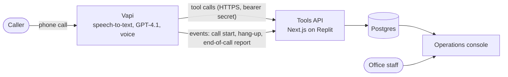

# Summit Air: Ava, the AI phone agent

Ava answers Summit Air's phone line, any hour of the day. She finds out what's wrong, keeps callers safe, recognizes returning customers and Comfort Club members, and either books a technician into a real arrival window or gets the right person to call back. Every call, booking and emergency lands in one operations console the office works from. Summit Air is a fictional residential HVAC company in New York City.

**The business outcome**

| | |
|---|---|
| **Every call answered, 24/7** | No voicemail, no hold queue during a heat wave or a cold snap |
| **Emergencies handled safely** | Gas, carbon monoxide and smoke get leave-now instructions before anything else. Medical signs get "call 911" first. Emergencies reach the on-call team with a **15-minute callback SLA** |
| **Routine work booked** | Real arrival windows, claimed atomically, with technician notes the tech can act on |
| **The office sees everything** | One console: the dispatch board, every call with its transcript and actions, and appointments |

<a id="for-revin-reviewers"></a>
## For reviewers: a 5-minute tour

1. **Call (347) 719-8328** and talk to Ava like a customer would: unscripted, interrupting, changing your mind.
2. **Watch it land** in the [operations console](https://summit-air-fde.replit.app) (password shared separately). The call appears on **Calls** within seconds.
3. **Open the call:** the transcript next to each action Ava took (lookup, triage, booking), with the triage reasons and timings.
4. **Skim [Key decisions](#key-decisions-and-tradeoffs)** below, then [ARCHITECTURE.md](docs/ARCHITECTURE.md) for the full ADRs.

## Try it

**Phone:** (347) 719-8328 · **Console:** https://summit-air-fde.replit.app

Your number isn't on file, so to be recognized as a returning customer, give the **last name** and **street address**. Ava reads nothing back until the address matches.

| Last name | Address | Membership |
|---|---|---|
| Marlowe-Venn | 37-12 82nd Street, Jackson Heights | Member |
| Quillfeather | 412 Seventh Avenue, Brooklyn | Member |
| Vandermeer | 250 West 85th Street, Apt 7B, Manhattan | Not a member |

Any other name is a new customer.

| Try | What should happen |
|---|---|
| **A returning member** (Marlowe-Venn): "My AC is making a rattling noise" | Verified by the street, greeted by first name, member benefits mentioned briefly, a window offered and booked on her account |
| **"I think I smell gas"** | Leave-now, call-911-from-outside instructions before any other question. Ava says clearly that Summit Air hasn't called 911. No booking; a safety-stop card on the dispatch board |
| **A new customer:** "I'd like a furnace tune-up," any Brooklyn, Queens or Manhattan address | Three spoken windows, a few technician questions one at a time, a read-back, a booking with technician notes on **Appointments** |
| **"My AC died, my grandmother is here, she's really hot and kind of confused"** | "Please call nine one one now" first. A priority request logged for the on-call team, and a callback promised within 15 minutes. Never "a technician is on the way" |

## What it handles

| Call | Outcome |
|---|---|
| Routine repair or tune-up | Booked into a real arrival window, with technician notes |
| No heat or AC with vulnerable people at home, or extreme temperatures | Priority request to the on-call team (15-minute callback) or the earliest window, per the triage rules |
| Gas smell, CO alarm or symptoms, smoke | Safety stop: leave-now instructions, a safety record on the board, no booking |
| Medical emergency signs | "Call 911" first, then a priority request |
| Returning customer or member | Verified by last name and street, then member benefits and their next appointment |
| Bronx or Staten Island address | "Our office will confirm coverage": a coverage-check callback, never a booking |
| Business, out of area, wrong number, sales pitch | Explained kindly and closed |
| Reschedule, cancel, billing, complaint, a person, another language | An office callback with the context (and the language noted) |
| A child on the line | No booking; a callback for a parent or guardian, with safety instructions still in force |

## How it works



**The model talks; code decides.** GPT-4.1 runs the conversation and chooses what to ask next. Everything that has to be right is decided in TypeScript behind authenticated tools:
- who the caller is, and what may be disclosed;
- how urgent the problem is;
- which windows exist, and whether a seat is still free.

Every tool result tells the model its next step. The prompt forbids claiming anything happened unless a tool returned `ok: true`. Details: [ARCHITECTURE.md](docs/ARCHITECTURE.md).

## Safety design

Layered, so no single failure (the model, a tool, the network) leaves an emergency unrecorded.

| # | Layer | Guarantee |
|---|---|---|
| 1 | **Prompt rules** | The safety script and "call 911" come first, and never depend on a tool |
| 2 | **Deterministic triage** | Urgency comes from rules in code (`triageRules`), not the model's judgment |
| 3 | **Caller-description matcher** | The caller's own words ("rotten eggs", "she's confused") escalate triage even when the model's flags miss them |
| 4 | **Emergencies fail open** | On any safety or medical sign, triage and dispatch never refuse for missing fields. Triage creates the dispatch record itself |
| 5 | **Booking guard and child-caller guard** | No booking on an emergency call or for a child; the backend refuses |
| 6 | **Hang-up safety net** | Before the line drops, the live transcript is checked and a missing safety record is created (waits ≤ 300 ms, never blocks the hang-up) |
| 7 | **Post-call reconciliation** | The end-of-call transcript gets the same check, as the final backstop |

The principle: **routine paths may fail closed; emergency and safety paths fail open.** See [ADR-9](docs/ARCHITECTURE.md#adr-9-safety-in-depth-emergencies-fail-open).

## Key decisions and tradeoffs

| Decision | Why |
|---|---|
| **Vapi** over a custom LiveKit / OpenAI Realtime stack | Telephony, turn-taking, transcription and simulations out of the box, so effort went into business logic. All logic sits behind our own HTTP tools, so the voice layer stays swappable. [ADR-13](docs/ARCHITECTURE.md#adr-13-vapi-as-the-voice-platform-kept-swappable) |
| **GPT-4.1** over GPT-4.1-mini | About 0.2 s slower per turn, but the failures seen live were instruction-following errors, which a smaller model makes more often. [ADR-12](docs/ARCHITECTURE.md#adr-12-model-gpt-41-over-gpt-41-mini) |
| **Deterministic triage in code** over letting the model decide | Urgency rules have real consequences and edge cases (seasons, thresholds, vulnerable occupants); code is testable and auditable. [ADR-2](docs/ARCHITECTURE.md#adr-2-deterministic-triage) |
| **Fail-open emergencies** over strict validation | A missing ZIP must never block a medical emergency. Routine calls still validate strictly. [ADR-9](docs/ARCHITECTURE.md#adr-9-safety-in-depth-emergencies-fail-open) |
| **Verify before disclose** over trusting caller ID | Caller ID can be spoofed. Nothing about an account is read back until the caller states a matching street address. [ADR-3](docs/ARCHITECTURE.md#adr-3-verify-before-disclose) |
| **Atomic seat claims** over check-then-book | Two callers can't take the last seat; members keep their held seat in the same SQL statement. [ADR-5](docs/ARCHITECTURE.md#adr-5-atomic-seat-claims) |
| **A controlled call ending** over Vapi's default hang-up | The default dropped the line ~0.1 s after the goodbye and the carrier clipped it. Now the goodbye is heard in full. [ADR-10](docs/ARCHITECTURE.md#adr-10-call-endings-the-goodbye-in-full-then-a-hang-up-we-control) |
| **Config as code** over dashboard edits | The prompt, tools and assistant are versioned in `vapi/`, diffed and published by `npm run vapi:sync`, and tested against the server's schemas. [ADR-6](docs/ARCHITECTURE.md#adr-6-vapi-config-as-code-synced-with-versioned-publishes) |

## Operations console

https://summit-air-fde.replit.app, password-protected. It refreshes live every 5 seconds.

| Page | What staff do there |
|---|---|
| **Overview** | "Needs attention now" (safety stops, emergencies not yet called back, anything past its SLA). Today's numbers, each linked to its records. Calls by hour, caller experience and system health |
| **Dispatch** | Work the board: **New → Called back** (stops the SLA clock) **→ Resolved** with an outcome (technician dispatched, appointment booked, no answer…). Every action is stamped with the operator's name and can be undone for 5 seconds |
| **Calls** | Every call with its outcome. Call detail shows the transcript, each action Ava took, and a **follow-up audit trail** (called back, resolved, appointment changes, by whom) |
| **Appointments** | Complete, no-show, cancel (frees the seat), or **reschedule from live availability** through the same atomic seat claim as booking, with history kept |

Test runs (Vapi simulations, web calls) and seed data are hidden by default and can be switched on.

## Testing and evidence

- **627 automated tests** run against a real Postgres database. **Scenario evals** cover the requirements plus a red-team set, including a 2-iteration safety suite.
- **Latency** (caller stops → Ava starts): **p50 ~1.46 s / p95 ~2.05 s**, down from 2.03 s / 3.18 s.
- **Live-testing issues** were root-caused, fixed and covered by regression tests. The safety fixes were re-verified by eval run `d895b5a2` (6/6).

Details: [docs/TESTING.md](docs/TESTING.md).

## Rolling this out at Summit Air

| Phase | What happens |
|---|---|
| **0. Shadow** | Staff answer every call. Ava runs on a copy of the line, and we compare her outcomes against what staff did |
| **1. After hours** | Ava answers after hours only; the office reviews every call daily |
| **2. Overflow during business hours** | Calls the office can't pick up roll to Ava instead of voicemail |
| **3. Primary line** | Ava answers first; staff work callbacks, transfers and the board |

- **Success metrics:** answer rate, booking conversion, emergency callback time, transfer rate, and caller hang-ups.
- **Weekly reviews:** evals run against scenarios drawn from real call patterns.
- **First engineering milestone:** field-service integration (ServiceTitan).

Exit criteria for each phase, metric definitions and risks: [docs/ROLLOUT.md](docs/ROLLOUT.md).

## Assumptions

- **Service area.** The brief mentions three service counties without naming them, so **Brooklyn, Queens and Manhattan** are assumed. Bronx and Staten Island addresses get an office coverage check, and anywhere else is declined. Changing it is a one-line config change (`serviceCounties` in `src/config/business.ts`).
- **15-minute callback SLA** for emergencies is a policy Ava states. She never says a technician is on the way.
- **Hours:** office Monday–Friday 8 AM–6 PM and Saturday 9 AM–2 PM; arrival windows Monday–Friday, 8 AM–5 PM.
- **Prices and membership:** diagnostic fee, tune-up price and Comfort Club benefits are placeholders. All values are listed in [LIMITATIONS.md](docs/LIMITATIONS.md#business-assumptions-to-confirm-srcconfigbusinessts).

## Open questions for Summit Air

1. Which three counties do you serve, and do you cover the Bronx or Staten Island?
2. After hours: what counts as dispatch-worthy, and who is on the on-call rotation?
3. Membership: which benefits and prices should Ava quote?
4. Are there issues your technicians want triaged differently?
5. Which field-service system do you use, and can we get API access?
6. Which languages do your callers speak?

## Run it locally

Requirements: Node 20.19+ and Postgres 16 or 17.

```bash
npm install
createdb summit_air_dev
cp .env.example .env      # set VAPI_TOOL_SECRET and DASHBOARD_PASSWORD
npm run db:migrate && npm run db:seed
npm run dev               # http://localhost:3000
npm test                  # creates and seeds summit_air_test
```

Environment variables, scripts and the Vapi sync workflow: [ARCHITECTURE.md, Reference](docs/ARCHITECTURE.md#reference).

## Deploy

**Before every republish**, run this in the Replit Shell:

```bash
git fetch origin && git reset --hard origin/main && npm ci && npm run db:migrate
```

**Then republish.** Replit diffs the development database's schema against production and proposes changes. If dev is behind, that diff contains destructive `DROP` statements. Migrating dev first makes the diff empty. **If the publish dialog shows any `DROP`, stop.**

On start, `start:deploy` runs the idempotent migrations, then the app. Vapi changes ship separately: `npm run vapi:sync -- --dry-run` to review, then `npm run vapi:sync`. See [ADR-7](docs/ARCHITECTURE.md#adr-7-idempotent-migrations-and-the-replit-schema-diff).
