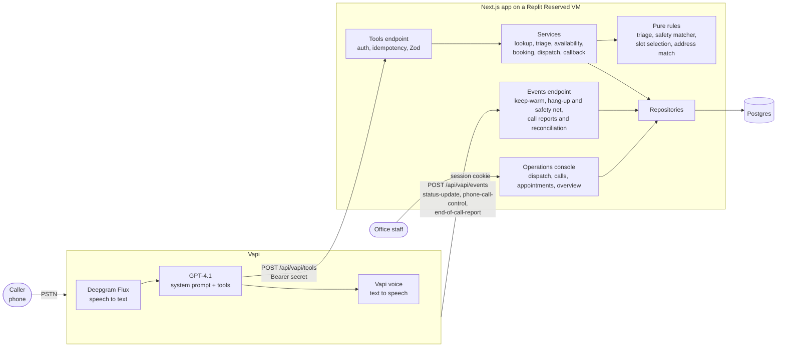
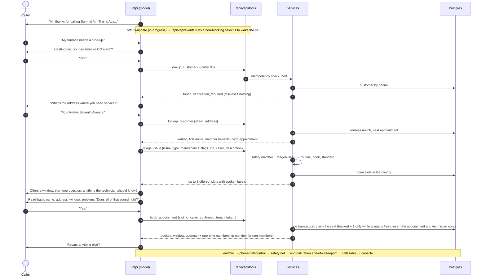

# Architecture

Ava, Summit Air's phone agent, is split in two:
- **Vapi** runs the call: telephony, speech-to-text (Deepgram Flux), the language model (GPT-4.1) and the voice.
- **This Next.js app** owns every business decision and every record: who the caller is, how urgent the problem is, which arrival windows exist, what gets booked, and what the office sees in the operations console.

The model talks to the caller and decides *what to ask next*. The backend decides *what is true and what is allowed*.

## Call flow

| Layer | Where | Responsibility |
|---|---|---|
| Voice and conversation | Vapi, configured from `vapi/` | Turn-taking, transcription, the model, the voice. The prompt (`vapi/system-prompt.md`) governs tone, order of questions and safety wording |
| Tools endpoint | `src/app/api/vapi/tools/route.ts` → `src/server/vapi/http.ts`, `dispatcher.ts` | Constant-time bearer check, idempotency, fail-open repair for emergencies, Zod validation with field-named errors, always HTTP 200 |
| Events endpoint | `src/app/api/vapi/events/route.ts` → `src/server/vapi/http.ts`, `call-control.ts` | Keep-warm on call start, the controlled hang-up with its safety net, end-of-call reports and post-call reconciliation |
| Services | `src/server/services/` | One per tool. They compose rules and data access, and return `{ ok, data, say }` |
| Pure rules | `src/server/triage/` (rules, safety matcher, child-caller signs), `src/server/scheduling/`, `src/server/lib/address-match.ts` | No I/O and no clock. The parts that most need to be right, so they're the most heavily tested |
| Repositories | `src/server/repositories/` | The only code that touches Drizzle/SQL |
| Operations console | `src/app/(console)/`, `src/server/console/` | Staff UI that reads the same tables the agent writes; every number comes from `src/server/console/metrics.ts` |
| Business assumptions | `src/config/business.ts` | Service ZIPs, seasons, SLAs, prices, membership wording. Each is marked `ASSUMPTION` |

## One booking call

## Design decisions

Short ADRs. Each one gives the context, the decision, and what it costs.

| ADR | Decision |
|---|---|
| [1](#adr-1-the-model-decides-what-to-ask-the-backend-enforces-whats-true) | The model decides what to ask; the backend enforces what's true |
| [2](#adr-2-deterministic-triage) | Deterministic triage |
| [3](#adr-3-verify-before-disclose) | Verify before disclose |
| [4](#adr-4-idempotency-keys-on-every-tool-call) | Idempotency keys on every tool call |
| [5](#adr-5-atomic-seat-claims) | Atomic seat claims |
| [6](#adr-6-vapi-config-as-code-synced-with-versioned-publishes) | Vapi config as code |
| [7](#adr-7-idempotent-migrations-and-the-replit-schema-diff) | Idempotent migrations and the Replit schema diff |
| [8](#adr-8-always-on-hosting) | Always-on hosting |
| [9](#adr-9-safety-in-depth-emergencies-fail-open) | Safety in depth: emergencies fail open |
| [10](#adr-10-call-endings-the-goodbye-in-full-then-a-hang-up-we-control) | Call endings: the goodbye in full, then a hang-up we control |
| [11](#adr-11-turn-taking-and-latency-measured) | Turn-taking and latency, measured |
| [12](#adr-12-model-gpt-41-over-gpt-41-mini) | GPT-4.1 over GPT-4.1-mini |
| [13](#adr-13-vapi-as-the-voice-platform-kept-swappable) | Vapi as the voice platform, kept swappable |
| [14](#adr-14-prompt-caching-a-stable-prefix) | Prompt caching: a stable prefix |

### ADR-1: The model decides what to ask; the backend enforces what's true

- **Context.** LLMs are good at conversation and unreliable at rules. They drift, misremember thresholds and say "you're booked" when they aren't. A wrong booking or a missed emergency costs far more than a slightly awkward phrase.
- **Decision.** The model extracts facts (issue type, flags, address as spoken, the caller's own words) and chooses wording. The backend decides urgency, availability, identity, capacity and what may be disclosed. Every tool result carries a `say` that ends with the next step ("Next: …"), so the call order lives in the tool results rather than in a checklist the model sees from the first turn. The prompt says never to claim an action happened unless that tool returned `ok: true`.
- **Tradeoff.** More tool calls and a stricter tool contract. In return, the outcomes that matter can be tested without a phone, and the owner can change a business rule in TypeScript instead of re-tuning a prompt.

### ADR-2: Deterministic triage

- **Context.** "No heat in winter, no AC with a medical condition or elderly resident, gas smell" are business rules with real consequences. They have edge cases: season boundaries, temperature thresholds, pregnancy versus medical conditions.
- **Decision.** `triageRules()` is a pure function of the extracted flags, the ZIP's service area and today's date. It returns urgency, human-readable reasons (shown to staff) and the next action. Safety stops override everything. Thresholds live in `business.ts`. The full mapping is in [Reference: triage rules](#triage-rules).
- **Tradeoff.** Triage is only as good as the extracted flags. Two mitigations:
  - The prompt asks the vulnerable-occupant question explicitly.
  - A deterministic matcher reads the caller's own words (`caller_description`) and can escalate a missed flag (ADR-9). The transcript and reasons on the console let staff audit every decision.

### ADR-3: Verify before disclose

- **Context.** Caller ID is spoofable, and a phone agent that reads back "I see you at 412 Seventh Ave, Comfort Club Plus" leaks PII to anyone holding the number.
- **Decision.** `lookup_customer` returns nothing about an account until the *caller* states a street address that matches one on file.
  - **Spoken forms are tolerated:** "thirty-seven twelve eighty-second street" and the STT form "37 12 80 second Street" both match 37-12 82nd St.
  - **No hints:** not-found and mismatch look identical, and three failed attempts lock verification for the call.
  - **Verified only:** next appointment, membership and equipment ride on the verified result.
  - **Lookup first:** every home call runs `lookup_customer` before triage or an unverified booking (`lookup_required` otherwise). Safety, medical and business calls are exempt.
- **Tradeoff.** A real customer who misspeaks their address is treated as new. That is safe, because booking never requires verification, but it can create a duplicate customer record that the office merges later.

### ADR-4: Idempotency keys on every tool call

- **Context.** Vapi retries on timeouts, and models sometimes repeat a tool call. A repeated `book_appointment` must not take two seats.
- **Decision.** Key = `callId:tool:sha256(canonicalJSON(args))`, unique in `tool_invocations`.
  - **Replays:** a repeat returns the stored result byte for byte. Only an `internal_error` (or a retryable refusal) is overwritten, so a transient failure can be retried.
  - **Per-record uniqueness:**
    - one active appointment per call, unique per (customer, slot);
    - one open callback per call (advisory-locked upsert);
    - one safety or priority record per call, created or merged under a per-call advisory lock (`ensureForCall`).
- **Tradeoff.** The same arguments with a deliberately different intent replay instead of re-running. On a phone call that's always the safer reading.

### ADR-5: Atomic seat claims

- **Context.** Two callers can choose the last window at the same moment. Members are promised first pick.
- **Decision.** One conditional `UPDATE … SET booked = booked + 1 WHERE booked < capacity − reserved RETURNING` inside the booking transaction.
  - **Member hold:** the member-held seat (the last seat in windows within 48 hours) is part of the same `WHERE`.
  - **Losing caller:** gets `slot_taken` with three alternatives. A test runs two concurrent bookings for one seat.
  - **Console reschedule:** uses the same claim (`seatClaimRules`), and cancelling releases the seat in the same transaction.
- **Tradeoff.** Capacity is counted in seats per window, not technician routes or drive time. That's adequate for a demo, and it's the first thing a field-service integration replaces.

### ADR-6: Vapi config as code, synced with versioned publishes

- **Context.** Hand-edited dashboard config drifts from the backend's tool schemas, and nobody can review or roll it back.
- **Decision.** The source of truth lives in the repo:
  - `vapi/system-prompt.md`, a template filled from `business.ts`;
  - `vapi/tools/*.json`;
  - `vapi/assistant.json`, with A/B variants in `vapi/variants/`.

  `npm run vapi:sync -- --dry-run` diffs against live Vapi. `npm run vapi:sync` upserts tools by name and updates the assistant, which publishes a new Vapi version that the script prints. A test checks every tool's JSON parameters against the server's Zod schema, so the two can't drift.
- **Tradeoff.** Someone editing in the Vapi dashboard gets overwritten on the next sync. That's intentional, but it has to be communicated.

### ADR-7: Idempotent migrations and the Replit schema diff

- **Context.** On republish, Replit diffs the *development* database's schema against production and applies the difference to production before our start command runs. Two consequences:
  - A plain `ALTER TABLE ADD COLUMN` in our migration then fails because Replit already added the column, and the app never boots.
  - When the dev database is *behind* (a migration ran on production but not in the workspace), the diff tries to make production match the older schema, so it proposes destructive `DROP COLUMN` / `DROP TABLE` statements. This happened once and was caught in the publish review before it ran.
- **Decision.**
  - Every migration after the initial baseline (`0000_init.sql`) uses `IF NOT EXISTS`. Migrations run on every start (`start:deploy`) under a Postgres advisory lock, so our migrator stays the source of truth.
  - Before every republish, the Replit Shell runs `git fetch origin && git reset --hard origin/main && npm ci && npm run db:migrate` (README, "Deploy"), so dev equals `main` and the platform diff is empty. Any `DROP` in the publish dialog means stop.
  - New fields prefer existing jsonb columns, and de-duplication prefers advisory locks over unique indexes, which could fail on rows that are already duplicated.
- **How a real deployment would do it.** Take schema changes away from the platform entirely:
  - a managed Postgres (Neon, RDS or Supabase) that the host reaches only through `DATABASE_URL`, with no platform-linked database and no auto-diff;
  - migrations applied once, by CI, as a release step, never on app start;
  - an app database role without DDL rights.
- **Tradeoff.** Hand-editing generated SQL after `db:generate`, and a manual pre-publish step that someone can forget. The README makes it the first deploy instruction.

### ADR-8: Always-on hosting

- **Context.** Vapi waits about 10 seconds for a tool result. A scale-to-zero host plus a suspended database can spend most of that on a cold start, while a caller sits in silence.
- **Decision.** A Replit Reserved VM (`deploymentTarget = "gce"`). The assistant sends `status-update`, and on `in-progress` the events endpoint fires a non-blocking `select 1`, so the database wakes during the greeting instead of on the first tool call. The Postgres pool keeps connections for 10 minutes, with keep-alive. When Neon suspends an idle connection anyway, the pool logs `db_pool_idle_error` and reconnects.
- **Tradeoff.** A fixed monthly cost even at zero calls, which is trivial next to one missed emergency.

### ADR-9: Safety in depth: emergencies fail open

- **Context.** The highest-stakes moments (gas, carbon monoxide, smoke, a medical emergency) are exactly when the model, a tool or the network might fail. Two failures from testing:
  - **Live call `01a15feb`:** a medical emergency was refused twice by triage validation (a missing smoke answer, then a missing ZIP), the dispatch was refused for missing `reasons`, and Ava hung up with no record made during the call.
  - **Eval runs:** the safety script was spoken but no tool was called.
- **Decision.** Layers, each independent of the one before. The principle: **routine paths may fail closed; emergency and safety paths fail open.**
  1. **Prompt rules.** The leave-now / call-911-from-outside script and "Please call nine one one now" come before any other question and never depend on a tool. Ava always says Summit Air has not called 911.
  2. **Deterministic triage** (ADR-2).
  3. **Caller-description matcher** (`src/server/triage/detect.ts`). It reads the caller's own words and can only escalate, forcing the gas, CO, smoke or medical path even when the model's flags miss them. It is negation-aware: "no gas smell" before a phrase, or "carbon monoxide, no." after it, doesn't count.
  4. **Fail open.** On any safety flag or matcher hit, `triage_issue` repairs its arguments instead of refusing:
     - unasked safety questions count as "no", recorded as `not_asked`;
     - invalid values are dropped;
     - the ZIP is optional.

     `create_priority_dispatch` needs only `issue_summary` (filled in too on an emergency call), derives its reasons, and updates the call's one record.
  5. **Triage records it itself.** A medical-emergency or safety-stop triage writes the dispatch record in the same request, under a per-call lock. Its `say` confirms the 15-minute callback and that 911 comes first.
  6. **Booking guards.** `book_appointment` refuses on any call triaged emergency or safety stop (`emergency_not_bookable`) and when a child is on the line (`minor_caller`, `src/server/triage/minor.ts`, conservative, with adult phrasings excluded).
  7. **Hang-up safety net** (phone calls). Before our server sends the end-call (ADR-10), it reads Vapi's live transcript (caller lines only) and this call's triage results. If the call needs a safety or priority record and has none, it creates one ("Auto-detected at hang-up"), including when no tool ran. It waits at most 300 ms and never blocks or fails the hang-up.
  8. **Post-call reconciliation.** The end-of-call transcript gets the same check, as the final backstop ("Auto-detected from transcript"). Phone calls only: chat simulations send no end-of-call report.
- **Tradeoff.**
  - **Over-alerting over missing:** fail-open accepts thin records (no ZIP or name). The on-call team calls back and fills them in.
  - **Speech is still the model's:** the exact wording and order of what Ava says depend on the model. Code guarantees the record and the refusals.
  - **Matcher limits:** English-only and conservative, so unusual wording can slip past layer 3. Layers 5 and 7 still catch any call that triage marked emergency.

### ADR-10: Call endings: the goodbye in full, then a hang-up we control

- **Current design.**
  1. **One goodbye.** The model never says goodbye. It calls `endCall`, whose blocking `request-start` message ("Thanks for calling Summit Air. Take care, and goodbye for now.") is the closing line. `endCallPhrases: ["goodbye for now"]` is the backstop.
  2. **We hang up.** With `phone-call-control` in `serverMessages`, Vapi delegates the hang-up to `/api/vapi/events`.
     - The endpoint answers 200 at once, never 5xx.
     - After the answer (Next's `after()`), it runs the safety net (ADR-9, ≤ 300 ms).
     - It then sends `{"type":"end-call"}` to `call.monitor.controlUrl`, `HANGUP_SEND_DELAY_MS` (default 0) after the goodbye ends, with retries 250, 500 and 1000 ms apart. A hard guard means the first attempt never goes out later than 1 s after the goodbye.
  3. **Every ending path is the same.** Goodbye, safety stop, commercial decline, non-service call, abusive caller and end-call phrase all produce the same hang-up request. A test checks every model × voice × target × endpointing combination.
- **Why.** With Vapi's own hang-up, the SIP BYE leaves ~0.1 s after the goodbye audio stops (pcap of call `01a15cfc`), and the caller's audio runs ~0.5–1 s behind ours, so the carrier clipped the last words even though the recording was complete.
- **What we learned getting here.**
  - Answering Vapi only after our end-call succeeded deadlocked: Vapi accepts the end-call only once its request has been answered. The line stayed open ~11 s (calls `01a15edf`, `01a15ee6`). Answer-first fixed it.
  - The BYE follows Vapi's receipt of our answer by ~3.0–3.3 s wherever our end-call lands (calls `01a15e9b`, `01a15f31`). Vapi's teardown, not our timing, sets a ~3.5 s floor.
  - When Vapi has already begun ending the call, our end-call can get HTTP 400 (seen on `01a15feb`). The call still ends normally, and the attempt is only logged.
- **Measured on every call.**
  - `npm run call-report` reads the SIP BYE from Vapi's packet capture and flags anything over 2.5 s.
  - The server logs `call_control_scheduled` and `call_control` per call.
- **Alternative kept for an A/B.** `npm run vapi:sync -- --ending native-padded` drops `phone-call-control`, so Vapi hangs up itself (~0.1 s), with a throwaway "… bye!" at the end of the goodbye so only that can be clipped. `controlled` is the default: the full goodbye heard, at the cost of ~3.5 s of silence before the line drops.

### ADR-11: Turn-taking and latency, measured

- **Measurements** (`npm run call-report`, waits = caller stops → Ava starts):

  | Config | p50 / p95 |
  |---|---|
  | Oct 20 night, LiveKit "Conservative" smart endpointing, nova-3 | 2030 / 3180 ms |
  | Oct 21 morning, Flux 0.7 / 3000 + wait 0.3 | 1504 / 2065 ms |
  | Oct 21 afternoon, `safe` (0.8 / 4000 + wait 0.2), call `01a15edf` | 1501 / 2941 ms, worst turn 5.5 s |
  | Oct 21 afternoon, **`fast`** (0.7 / 3000 + wait 0.2), call `01a15ee6` | **1461 / 2054 ms**, worst turn 3.7 s, 0 overlaps |

  Morning breakdown (p50): transcriber/end-of-turn ~397 ms, model time to first token ~473 ms, voice ~253 ms, plus `waitSeconds`.
- **Decision.**
  - **Endpointing:** Deepgram Flux end-of-turn with two presets (`--endpointing fast|safe`, `vapi/variants/endpointing/`). **`fast` is the default**: it beat `safe` on every measure in a live A/B, and the caller said it felt much better.
  - **Other levers:** a 5-character first TTS chunk, short openers and turns (one or two sentences, about 25 words), 1–3-word tool fillers, a 24-hour prompt cache (ADR-14), and pooled Postgres connections.
- **Measurement notes.**
  - **Vapi's "transcriber p95 ~2.6 s" is an artifact, not a delay.** Vapi anchors it at its own VAD event, often the start of the caller's sentence. Flux sent end-of-turn ~0.2 s after the audio it had seen. The caller-side wait is the number to watch.
  - **Cut-ins, corrected.** call-report had Vapi's two interruption counters swapped. The morning call had 1 Ava cut-in and 4 caller barge-ins, all during 8–14 s Ava turns, which the turn-length rule fixed.
  - **Flux keyterms confirmed:** Vapi's call log shows all 48 keyterms on the Flux connection.
- **Tool overhead.** Vapi measures the tool webhook at ~0.7–1.3 s. About 0.56–0.66 s of that is transport (Vapi → Replit edge → VM and back) that even instant replies pay. Ours was a +215 ms reconnect after 30 s idle (fixed with the 10-minute pool) plus sequential ~27 ms queries, because the database isn't in the VM's region. Co-locating the database and VM, ideally near Vapi (us-west-2), is the remaining infra step.

### ADR-12: Model: gpt-4.1 over gpt-4.1-mini

- **Context.**
  - **Speed:** gpt-4.1's time to first token was p50 ~473 ms on the measured call; gpt-4.1-mini would save roughly 0.2 s per turn.
  - **Load on the model:** the prompt carries ~20 behavioral rules the backend can't enforce (call order, read-back, no invented facts, one outcome per call), and 7 tools with multi-step sequencing.
  - **Observed failures:** every error seen live was an instruction-following error (re-asking verified data, invented policy, parroting a misheard word). Those get more likely with a smaller model.
- **Decision.** Keep **gpt-4.1** as the default (owner's call, Oct 21) at temperature 0.5. Latency work goes into endpointing, turn length, the DB pool and caching instead. `gpt-4.1-mini` and `gpt-5.4-mini` stay available as `--variant`s for measured A/B tests, never silent switches.
- **Tradeoff.** About 0.2 s per turn in exchange for accuracy on a call where a wrong booking or a missed safety cue costs far more.

### ADR-13: Vapi as the voice platform, kept swappable

- **Context.** A phone agent needs telephony, streaming speech-to-text, turn-taking, an LLM, streaming text-to-speech, barge-in handling, recordings and a way to test conversations. Building that on LiveKit Agents or the OpenAI Realtime API gives more control over latency and audio, at the cost of weeks of infrastructure before the first business rule.
- **Decision.** Vapi for the voice layer, with every business rule behind our own authenticated HTTP tools. What Vapi provides:
  - phone numbers and SIP;
  - Deepgram Flux end-of-turn;
  - per-call logs and packet captures (the basis of `call-report`);
  - scenario simulations (the eval suite);
  - versioned assistants (ADR-6).
- **Swappability.** Nothing Vapi-specific sits below `src/server/vapi/` (envelope parsing, call control):
  - the services, rules, repositories and console don't know Vapi exists;
  - a LiveKit or Realtime front end would call the same tools API, with the same Zod schemas and `say` contract;
  - inside Vapi, model and voice are already swappable variants (`--variant`, `--voice`);
  - a speech-to-speech target (`vapi/targets/s2s.json`, [S2S_EXPERIMENT.md](S2S_EXPERIMENT.md)) runs against the same backend.
- **Tradeoff.** Less control where Vapi decides: the teardown floor (ADR-10), the transport cost per tool call (ADR-11), and metric definitions (the transcriber artifact). Each one is measured, so a move would be justified by numbers.

### ADR-14: Prompt caching: a stable prefix

- **Context.** The system prompt is about 3,700 words (~5,500 tokens). Re-processing it on every turn adds model latency and cost.
- **Decision.**
  - **Stable prefix:** the template keeps everything that varies per call (Vapi Liquid `{{ }}` and ``: date, time, caller ID status) in the **last** section, "This call". Everything above is an identical prefix on every call, so OpenAI's automatic prompt caching applies.
  - **Retention:** `promptCacheRetention: "24h"` in `vapi/assistant.json` keeps it warm between calls.
  - **Locked in by tests:** a test checks the dynamic parts stay at the end.
- **Tradeoff.** Per-call context can't be woven through the prompt; it has to live at the end and be referenced from there.

## Data model (short)

| Table | Written by | Read by |
|---|---|---|
| `customers`, `service_addresses`, `memberships`, `equipment` | seed, `book_appointment` (new callers and addresses) | `lookup_customer`, console |
| `appointment_slots` | seed; seats claimed and released by booking, cancel and reschedule | `triage_issue`, `get_availability`, `book_appointment` |
| `appointments` (`intake` jsonb, `technician_notes`, lifecycle and `rescheduled_from`) | `book_appointment`, the console (complete, no-show, cancel, reschedule) | `lookup_customer` (next appointment), console |
| `dispatch_requests` (`intake` jsonb, resolution) | `triage_issue` (safety stop, medical emergency), `create_priority_dispatch`, the hang-up safety net, post-call reconciliation, the console (called back, resolved) | dispatch board, call detail |
| `callback_requests` | `create_callback_request`, the console | dispatch board, call detail |
| `tool_invocations` | dispatcher (every call, with latency and a test-run flag) | idempotency, verification lockout, call timeline, system health |
| `calls` | `end-of-call-report` | calls list, call detail, metrics |

## Reference

### Tools

The dispatcher (`src/server/vapi/dispatcher.ts`) handles every tool call the same way:
1. Parses `toolCallList` (arguments as an object or a JSON string).
2. Replays a stored result for the same idempotency key.
3. Runs the tool's fail-open `prepare` step where it has one.
4. Validates with Zod (errors name each bad field).
5. Runs the handler and records the call in `tool_invocations`.
6. Always answers HTTP 200 with one single-line JSON `result` or `error` per tool call.

All tools treat `""`, whitespace-only and `null` in an optional field as omitted.

| Tool | What it does |
|---|---|
| `lookup_customer` | Identity verification by caller ID or last name, confirmed by the street address the caller says (ADR-3). Verified results carry member benefits and the next appointment |
| `check_service_area` | Answers "do you cover my area?" only; never replaces lookup or triage |
| `triage_issue` | `triageRules()` plus the safety matcher → urgency, reasons, next action, up to 3 offered windows. Fails open and records the safety or priority request itself on emergencies (ADR-9) |
| `get_availability` | Later, morning, afternoon or weekday follow-ups |
| `book_appointment` | Requires `caller_confirmed: true`. One transaction: customer, address, atomic seat claim (ADR-5), appointment with technician notes. Refuses emergencies and child callers |
| `create_priority_dispatch` | The call's priority request for the on-call team (created or updated). Returns the 15-minute callback policy, never "technician en route" |
| `create_callback_request` | Office callback for failures, out-of-area, human requests, reschedules, office review, languages; one per call |
| `transfer_to_on_call` | Vapi `transferCall` (blind), attached only when `ON_CALL_TRANSFER_NUMBER` is set |

### Triage rules

| Situation | Urgency → next step |
|---|---|
| Gas smell, CO alarm or symptoms, burning smell or smoke | `safety_stop` → leave-now instructions, safety record, no booking (overrides everything) |
| Medical emergency signs at home (confused, fainting, trouble breathing…) | `emergency` → "call 911" first, priority request |
| No heat in heat season (Oct 1 – May 31) with a vulnerable occupant, or indoor ≤ 55°F | `emergency` → priority request |
| No AC with a medically vulnerable occupant in cooling season (Jun 1 – Sep 30) or indoor ≥ 85°F | `emergency` → priority request |
| No heat in heat season; no AC in cooling season; no AC with any vulnerable occupant; an active leak | `urgent` → earliest window (48 h) |
| Everything else (maintenance, noise, thermostat, out-of-season with nobody vulnerable) | `routine` → standard windows (14 days) |
| Commercial property or a ZIP outside NYC | `explain_and_close` |
| Bronx or Staten Island ZIP | `office_review` → coverage-check callback, never booked |
| Building-wide central system serving several units | `office_review` (emergencies still go to the on-call team) |

Vulnerable occupants: elderly, infant, medical condition, pregnant, medical equipment, disability.

### Operations console

- **Rendering and data:** server components read through `src/server/repositories/console.ts`, with pure derivations in `src/server/console/`. Every number comes from `metrics.ts`, so the sidebar, Overview and Calls always agree.
- **Live updates:** pages poll every 5 seconds while the tab is visible. Times are in `APP_TIMEZONE` (America/New_York).
- **Test-run filtering:** Vapi simulations and web calls are flagged when they arrive (`is_simulation`) and hidden with seed data unless switched on.
- **Auth:** `src/proxy.ts` requires a session on everything except `/login`, `/api/vapi/*` and `/api/health`. The session cookie is an HMAC-signed expiry keyed from `DASHBOARD_PASSWORD` (HKDF). Failed logins are limited to 5 per client per 15 minutes. Server Actions and loaders re-check the session themselves.

### Environment variables

Validated with Zod in `src/lib/env.ts`; the server exits at boot if any are invalid.

| Variable | Required | Notes |
|---|---|---|
| `DATABASE_URL` | yes | `postgres://…` |
| `VAPI_TOOL_SECRET` | yes | 16+ chars; Vapi sends it as `Authorization: Bearer …` |
| `DASHBOARD_PASSWORD` | yes | 8+ chars; the console password (changing it signs everyone out) |
| `APP_URL` | yes | Public base URL |
| `APP_TIMEZONE` | no | Default `America/New_York` |
| `ON_CALL_TRANSFER_NUMBER` | no | E.164. Set: triage offers a transfer and `vapi:sync` attaches `transfer_to_on_call` |
| `DEMO_CALLER_PHONES` | no | `<phone>=<customer uuid>,...`: map a reviewer's phone to a seeded customer (who still has to say the street) |
| `ASSISTANT_REQUEST_ENABLED` | no | Default `false`. `/api/vapi/assistant-request` tells the prompt the caller ID is recognized (no account details) |
| `HANGUP_SEND_DELAY_MS` | no | Default 0 (0–1000): delay after the goodbye before our end-call (ADR-10) |
| `VAPI_API_KEY`, `VAPI_CREDENTIAL_ID`, `VAPI_ASSISTANT_ID`, `VAPI_EVAL_PERSONALITY_ID`, `VAPI_S2S_ASSISTANT_ID` | sync and evals only | Local `.env`; not needed on the server |
| `TEST_DATABASE_URL` | no | Default `postgres://localhost:5432/summit_air_test` (the name must contain "test") |

### Scripts

| Script | What it does |
|---|---|
| `dev` / `build` / `start` / `start:deploy` | Next.js; `start:deploy` runs `db:migrate` first (used by Replit) |
| `lint` / `typecheck` / `test` | ESLint / `next typegen && tsc` / Vitest against a real Postgres |
| `db:generate` / `db:migrate` | Generate SQL from `src/server/db/schema.ts` (then add `IF NOT EXISTS`, ADR-7) / apply migrations under an advisory lock |
| `db:seed` | Idempotent fictional data: customers, NYC ZIPs, 10 business days of arrival windows, demo call activity |
| `db:reset-test` | Deletes everything calls created and keeps seed data. Dry run unless `-- --confirm`. Runs against `DATABASE_URL` |
| `vapi:sync` | Upsert tools and publish the assistant (ADR-6). `-- --dry-run` diffs only. A/B flags: `--variant`, `--voice`, `--endpointing`, `--ending`, `--target` |
| `vapi:set-default` | Record which variants a plain `vapi:sync` publishes |
| `call-report` | Read-only latency and ending report for a call (ADR-11, [TESTING.md](TESTING.md#4-latency-measurement-npm-run-call-report)) |
| `evals` | Vapi scenario simulations ([TESTING.md](TESTING.md#2-scenario-evals-npm-run-evals)) |

### Vapi configuration

- **Persona.** "Ava, Summit Air's virtual assistant", GPT-4.1 at temperature 0.5. She says she's an AI if asked.
- **Pronunciation.** The greeting says plain "Ava": a respelling ("Ayva") was read as "EYE-vuh", and the earlier "Eva" was a transcription issue, not the voice. Brand names the voice mangles (Navien, Weil-McLain) are respelled before synthesis (`voice.chunkPlan.formatPlan`).
- **Voice.** Vapi "Emma" (v2) by default. Cartesia, ElevenLabs and xAI alternatives are variants in `vapi/variants/voice/` for A/B tests by ear. Background sound is off.
- **Greeting.** It opens with skippable words ("Hi, thanks for calling…") because Vapi has no first-message delay for inbound calls.
- **Workflow.** Never edit in the Vapi dashboard. Run `npm run vapi:sync -- --dry-run`, review, then `npm run vapi:sync`. Each changed publish creates a new assistant version, which the script prints.
