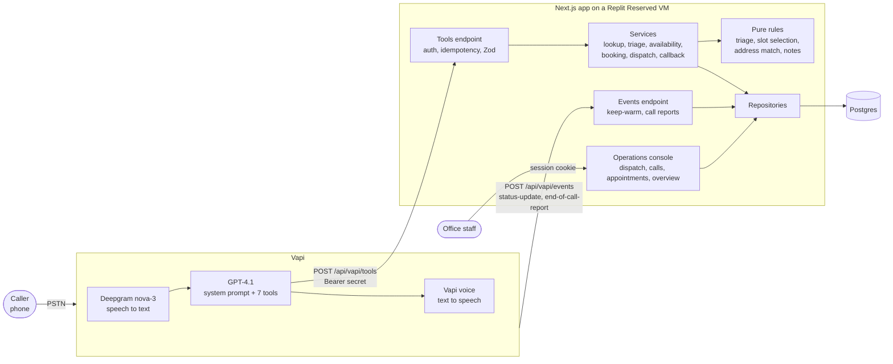

# Architecture

Summit Air's phone agent is split in two. **Vapi** runs the call: telephony, speech-to-text (Deepgram), the language model (GPT-4.1) and text-to-speech. **This Next.js app** owns every business decision and every record: who the caller is, how urgent the problem is, which arrival windows exist, what gets booked, and what the office sees.

The model talks to the caller and decides *what to ask next*. The backend decides *what is true and what is allowed*.

## Call flow



| Layer | Where | Responsibility |
|---|---|---|
| Voice and conversation | Vapi, configured from `vapi/` | Turn-taking, transcription, the model, the voice. The prompt (`vapi/system-prompt.md`) governs tone, order of questions and safety wording |
| Tools endpoint | `src/app/api/vapi/tools/route.ts` → `src/server/vapi/http.ts`, `dispatcher.ts` | Constant-time bearer check, idempotency, Zod validation with field-named errors, always HTTP 200 |
| Services | `src/server/services/` | One per tool. They compose rules and data access, and return `{ ok, data, say }` |
| Pure rules | `src/server/triage/rules.ts`, `src/server/scheduling/`, `src/server/lib/address-match.ts` | No I/O and no clock. The parts that most need to be right, so they're the most heavily tested |
| Repositories | `src/server/repositories/` | The only code that touches Drizzle/SQL |
| Console | `src/app/(console)/`, `src/server/console/` | Staff UI that reads the same tables the agent writes |
| Business assumptions | `src/config/business.ts` | Service ZIPs, seasons, SLAs, prices, membership wording. Each is marked `ASSUMPTION` |

## One booking call

```mermaid
sequenceDiagram
    autonumber
    actor C as Caller
    participant V as Vapi (model)
    participant T as /api/vapi/tools
    participant S as Services
    participant DB as Postgres

    V->>C: "Hi, thanks for calling Summit Air! This is Ava..."
    Note over V,T: status-update (in-progress) → /api/vapi/events runs a non-blocking select 1 to wake the DB
    C->>V: "My furnace needs a tune-up."
    V->>C: Safety screen: gas smell or CO alarm?
    C->>V: "No."
    V->>T: lookup_customer {} (caller ID)
    T->>S: idempotency check, Zod
    S->>DB: customer by phone
    S-->>V: found, verification_required (discloses nothing)
    V->>C: "What's the address where you need service?"
    C->>V: "Four twelve Seventh Avenue."
    V->>T: lookup_customer {street_address}
    S->>DB: address match, next appointment
    S-->>V: verified, first name, member benefits, next_appointment
    V->>T: triage_issue {issue_type: maintenance, flags, zip}
    S->>S: triageRules() → routine, book_standard
    S->>DB: open slots in the county
    S-->>V: up to 3 offered_slots with spoken labels
    V->>C: Offers a window, gathers technician intake one question at a time
    V->>C: Read-back: name, address, window, problem. "Does all of that sound right?"
    C->>V: "Yes."
    V->>T: book_appointment {slot_id, caller_confirmed: true, intake...}
    S->>DB: BEGIN; UPDATE slot SET booked = booked + 1 WHERE booked < capacity − held RETURNING; INSERT appointment + technician_notes; COMMIT
    S-->>V: booked, window, address (+ one-time membership mention for non-members)
    V->>C: Recap, anything else?
    Note over V,DB: end-of-call-report → calls table (summary, transcript) → console
```

## Design decisions

Short ADRs. Each one gives the context, the decision, and what it costs.

### ADR-1: The model decides what to ask; the backend enforces what's true

- **Context.** LLMs are good at conversation and unreliable at rules. They drift, misremember thresholds and say "you're booked" when they aren't. A wrong booking or a missed emergency costs far more than a slightly awkward phrase.
- **Decision.** The model extracts facts (issue type, flags, address as spoken) and chooses wording. The backend decides urgency, availability, identity, capacity and what may be disclosed. Each tool result carries a `say` hint, and the prompt says never to claim an action happened unless that tool returned `ok: true`.
- **Tradeoff.** More tool calls and a stricter tool contract. In return, the outcomes that matter can be tested without a phone. The owner can change a business rule in TypeScript instead of re-tuning a prompt.

### ADR-2: Deterministic triage

- **Context.** "No heat in winter, no AC with a medical condition or elderly resident, gas smell" are business rules with real consequences. They have edge cases: season boundaries, temperature thresholds, pregnancy versus medical conditions.
- **Decision.** `triageRules()` is a pure function of the flags the model extracted, the ZIP's service area and today's date. It returns urgency, human-readable reasons (shown to staff) and the next action. Safety stops override everything. Thresholds live in `business.ts`.
- **Tradeoff.** Triage is only as good as the extracted flags. If the model misses "my dad is 82", the rules can't recover. The prompt therefore asks the vulnerable-occupant question explicitly, and the transcript plus reasons on the console let staff audit it.

### ADR-3: Verify before disclose

- **Context.** Caller ID is spoofable, and a phone agent that reads back "I see you at 412 Seventh Ave, Comfort Club Plus" leaks PII to anyone holding the number.
- **Decision.** `lookup_customer` returns nothing about an account until the *caller* states a street address that matches one on file. Spoken forms are tolerated ("thirty-seven twelve eighty-second street" and the STT form "37 12 80 second Street" both match 37-12 82nd St). Not-found and mismatch look identical. Three failed attempts lock verification for the call. Next appointment, membership and equipment ride on the verified result only.
- **Tradeoff.** A real customer who misspeaks their address is treated as new. That is safe, because booking never requires verification, but it can create a duplicate customer record that the office merges later.

### ADR-4: Idempotency keys on every tool call

- **Context.** Vapi retries on timeouts, and models sometimes repeat a tool call. A repeated `book_appointment` must not take two seats.
- **Decision.** Key = `callId:tool:sha256(canonicalJSON(args))`, unique in `tool_invocations`. A replay returns the stored result byte for byte. Only an `internal_error` is overwritten, so a transient failure can be retried. Bookings are also unique per (customer, slot), and dispatches are de-duplicated per call.
- **Tradeoff.** The same arguments with a deliberately different intent replay instead of re-running. On a phone call that's always the safer reading.

### ADR-5: Atomic seat claims

- **Context.** Two callers can choose the last window at the same moment. Members are promised first pick.
- **Decision.** One conditional `UPDATE … SET booked = booked + 1 WHERE booked < capacity − reserved RETURNING` inside the booking transaction. The member-held seat (the last seat in windows within 48 hours) is part of the same `WHERE`. A losing caller gets `slot_taken` with three alternatives. A test runs two concurrent bookings for one seat.
- **Tradeoff.** Capacity is counted in seats per window, not technician routes or drive time. That's adequate for a demo, and it's the first thing a real FSM integration replaces.

### ADR-6: Vapi config as code, synced with versioned publishes

- **Context.** Hand-edited dashboard config drifts from the backend's tool schemas, and nobody can review or roll it back.
- **Decision.** `vapi/system-prompt.md` (a template filled from `business.ts`), `vapi/tools/*.json` and `vapi/assistant.json` are the source of truth. `npm run vapi:sync -- --dry-run` diffs against live Vapi, and `npm run vapi:sync` upserts tools by name and updates the assistant, which publishes a new Vapi version that the script prints. A test checks every tool's JSON parameters against the server's Zod schema, so the two can't drift.
- **Tradeoff.** Someone editing in the Vapi dashboard gets overwritten on the next sync. That's intentional, but it has to be communicated.

### ADR-7: Idempotent migrations and the Replit schema diff

- **Context.** On republish, Replit diffs the *development* database's schema against production and applies the difference to production before our start command runs. Two consequences:
  - A plain `ALTER TABLE ADD COLUMN` in our migration then fails because Replit already added the column, and the app never boots.
  - Worse, when the dev database is *behind* (a migration ran on production but not in the workspace), the diff tries to make production match the older schema, so it proposes destructive `DROP COLUMN` / `DROP TABLE` statements. This happened once and was caught in the publish review before it ran.
- **Decision.**
  - Every migration after the initial baseline (`0000_init.sql`) uses `IF NOT EXISTS`. Migrations run on every start (`start:deploy`) under a Postgres advisory lock, so our migrator stays the source of truth.
  - Before every republish, the Replit Shell runs `git fetch origin && git reset --hard origin/main && npm ci && npm run db:migrate` (README, "Deploying to Replit"), so dev equals `main` and the platform diff is empty. Any `DROP` in the publish dialog means stop.
  - The live-call tuning (Oct 21) needed no migration: new fields live in existing jsonb columns, and callback de-duplication uses an advisory lock instead of a unique index. An index could fail on production rows that are already duplicated.
- **How a real deployment would do it.** Take schema changes away from the platform entirely: a managed Postgres (Neon, RDS or Supabase) that the host only reaches through `DATABASE_URL`, with no platform-linked database and no auto-diff; migrations applied once, by CI, as a release step (`drizzle-kit migrate` against production with a reviewed SQL diff), never on app start; and a database role for the app that has no DDL rights, so nothing at runtime can drop a column.
- **Tradeoff.** Hand-editing generated SQL after `db:generate`, and a manual pre-publish step that someone can forget. The README makes it the first deploy instruction.

### ADR-8: Always-on hosting

- **Context.** Vapi waits about 10 seconds for a tool result. A scale-to-zero host plus a suspended database can spend most of that on a cold start, while a caller sits in silence.
- **Decision.** Replit Reserved VM (`deploymentTarget = "gce"`). The assistant sends `status-update`, and on `in-progress` the events endpoint fires a non-blocking `select 1`, so the database wakes during the greeting instead of on the first tool call.
- **Tradeoff.** A fixed monthly cost even at zero calls, which is trivial next to one missed emergency.

### ADR-9: A fail-safe safety script that doesn't depend on tools

- **Context.** The highest-stakes moment (a gas smell or CO alarm) is exactly when the backend might be down.
- **Decision.** The leave-now / call-911-from-outside script is in the system prompt and is spoken *before* any tool call. The prompt says it never depends on a tool. `triage_issue` then records a `safety_stop` follow-up as best effort, and its `say` adapts if recording failed ("Do not say the office was notified"). The agent always says Summit Air has not called 911.
- **Tradeoff.** The model is trusted to recognize the trigger. Mitigations: the explicit safety-screen question on every call, Deepgram keyterms for "carbon monoxide", and a live scenario and eval for it (`e-gas-smell`).

### ADR-10: Call endings: endCall speaks the goodbye; one end-call phrase as a backstop

- **Context.** Live calls ended badly. The model said its own goodbye, then Vapi spoke `endCallMessage` and the line was cut off mid-word ("Take"). On another call Ava re-engaged after goodbye, and a stray transcribed "2" got a reply.
- **Decision.** Per Vapi's hang-up docs (docs.vapi.ai/tools/hang-up, checked Oct 21, 2026):
  - When the `endCall` tool has a `request-start` message, Vapi speaks that message instead of `endCallMessage` and then ends the call. Ours is "Thanks for calling Summit Air. Take care, and goodbye for now." with `blocking: true`, which means the tool, and so the hang-up, waits until the message is spoken.
  - The prompt tells the model never to say goodbye itself: as soon as the caller declines "anything else?" or says bye, it calls `endCall`. It never re-engages after a goodbye and ignores stray words.
  - Backstop: `endCallPhrases: ["goodbye for now"]`. The end-call-phrases doc is the only one that explicitly says Vapi waits for the assistant to finish speaking before hanging up. The phrase is the tail of the closing line, so any path that speaks the closing line ends the call after it.
  - The phrase must appear nowhere else (phrases match any assistant speech). A test enforces that against the greeting, the prompt and the tool messages.
  - Safety stops: the prompt waits for the caller to acknowledge the instructions before `endCall`.
- **Tradeoff.**
  - Vapi doesn't document whether `blocking` governs the endCall hang-up specifically, or whether the end-call phrase matches the tool's spoken message rather than only model text. Community threads report hang-ups racing TTS. So this needs a live listen before we trust it.
  - The fallback, if it still clips, is to drop the tool message and have the model say the closing line itself, relying only on `endCallPhrases`.

### ADR-11: Turn-taking and latency

- **Context.** Ava cut in while callers paused mid-thought. `onPunctuationSeconds: 0.1` ended a turn 100 ms after any sentence break. Tools run in 58–324 ms in production, so the remaining pauses are endpointing plus model time.
- **Decision.**
  - **Smart endpointing:** `startSpeakingPlan.smartEndpointingPlan` = LiveKit, which Vapi recommends for English. A text model estimates the probability *x* that the caller is still talking, and `waitFunction` maps it to a wait. We use the docs' "Conservative" curve, `700 + 4000 * max(0, x-0.5)`: about 0.7 s when they're clearly done, up to 2.7 s mid-sentence.
  - **Digits:** a `customEndpointingRule` waits 1.5 s after Ava asks for an address, phone number or ZIP, because people pause while reading digits.
  - **Fallback values:** `transcriptionEndpointingPlan` is only used if smart endpointing is off, and is loosened to 0.5 / 1.0 / 0.8 s. `waitSeconds` is back to 0.4 (Vapi's default) because the smart wait already supplies the patience.
  - **Interruptions:** `stopSpeakingPlan.numWords: 2`, so "uh-huh" doesn't stop Ava.
- **Latency budget elsewhere.**
  - The prompt now puts the per-call date line last, so ~98% of it is an identical prefix on every call that OpenAI caches automatically. Before, the date sat in the second paragraph and nothing after it could be cached.
  - The prompt was tightened by ~6% despite new rules.
  - The call order now gets to `triage_issue` (which returns the windows) with at most two technician questions first.
  - Every tool has a non-blocking `request-start` filler that plays as soon as it's called.
  - A faster model (`gpt-4.1-mini`) is documented in `assistant.json` but not switched.
- **Tradeoff.**
  - The conservative curve adds roughly 0.3–0.6 s before Ava answers a short, clearly finished reply. That is the price of not interrupting.
  - If calls feel sluggish, the faster documented curve is the spec default `20 + 500 * sqrt(x) + 2500 * x^3`.
  - Deepgram Flux (end-of-turn detection inside the transcriber) is the other option, but Vapi doesn't document whether `keyterm` works on Flux, and our keyterms carry brand and street names.

## Data model (short)

| Table | Written by | Read by |
|---|---|---|
| `customers`, `service_addresses`, `memberships`, `equipment` | seed, `book_appointment` (new callers and addresses) | `lookup_customer`, console |
| `appointment_slots` | seed | `triage_issue`, `get_availability`, `book_appointment` (atomic claim) |
| `appointments` (`intake` jsonb, `technician_notes`) | `book_appointment` | `lookup_customer` (next appointment), console |
| `dispatch_requests` | `triage_issue` (safety stop), `create_priority_dispatch` | dispatch board |
| `callback_requests` | `create_callback_request` | dispatch board |
| `tool_invocations` | dispatcher (every call, with latency) | idempotency, verification lockout, call timeline |
| `calls` | `end-of-call-report` | calls list, call detail |
